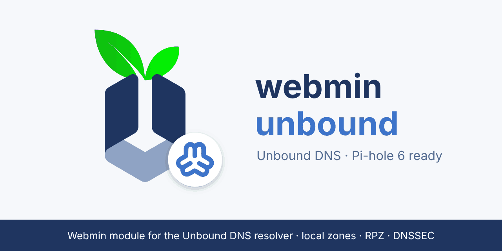

<p align="center"></p>

#  Modulo Webmin per Unbound DNS e Pi-hole

[English](README.en.md) · **Italiano**

**⬇️ Download: [unbound.wbm.gz](https://github.com/ohosys/webmin-unbound/releases/latest/download/unbound.wbm.gz)** (ultima versione, da installare in Webmin; tutte le versioni nelle [release](https://github.com/ohosys/webmin-unbound/releases/latest)).

> Non usare *Code → Download ZIP* né gli archivi *Source code* della release: contengono
> tutto il repository, non il modulo, e Webmin risponde "missing a module.info file".

Modulo Webmin (Perl, stesso stile dei moduli ufficiali) per gestire **Unbound**
e, sulla stessa macchina, **Pi-hole 6** che lo usa come server a monte (la
configurazione della [guida ufficiale](https://docs.pi-hole.net/guides/dns/unbound/)).

**Cosa fa il progetto in breve:** da un'unica pagina di Webmin si gestisce tutta la
catena DNS di casa o dell'ufficio: Pi-hole risponde ai client e blocca pubblicità e
tracker; Unbound risolve in modo ricorsivo, valida DNSSEC e contiene i nomi locali
della rete. Il modulo tiene i due allineati (cache, inoltro delle zone locali,
upstream) e avvisa prima di qualunque modifica che lascerebbe la rete senza DNS.

Per Unbound:
zone e record locali, importazione in blocco, zone di inoltro, stub e
autoritative, blocklist RPZ, viste per client, controllo accessi, DNSSEC, cache
e statistiche. Interfaccia in inglese e italiano. Versione 1.8.

Distribuzioni provate: **Ubuntu 24.04** (deb), **Rocky Linux 9** e **Fedora 42** (rpm).
Pi-hole è facoltativo: senza, il modulo gestisce solo Unbound.

È integrato con il resto di Webmin come un modulo ufficiale:
- **Stato di sistema e server**: monitor con avvisi email.
- **Dashboard**: stato e statistiche.
- **Log di sistema**: il file di log di Unbound.
- **Ricerca globale**: collegamenti diretti alle pagine.
- **Segnalazioni di bug**: allega i file di configurazione.
- **Backup della configurazione**.
- **Configurazione di rete**: imposta il resolver di sistema.

## Installazione

1. Webmin → *Webmin Configuration* → *Webmin Modules* → *Install Module*, poi:
   - *From uploaded file*: il file [unbound.wbm.gz](https://github.com/ohosys/webmin-unbound/releases/latest/download/unbound.wbm.gz) scaricato dal link sopra
     (è uguale a `dist/unbound-1.8.wbm.gz` di questo repository; per ricostruirlo dai
     sorgenti: `./make-package.sh`);
   - oppure *From ftp or http URL*: `https://github.com/ohosys/webmin-unbound/releases/latest/download/unbound.wbm.gz`
     (serve che Webmin possa fare connessioni HTTPS, cioè il modulo Perl `Net::SSLeay`).
2. Il modulo compare in *Servers → Unbound DNS Server*.
3. Le nuove impostazioni vanno in un file a parte, creato al primo salvataggio:
   `/etc/unbound/unbound.conf.d/webmin.conf` su Debian/Ubuntu,
   `/etc/unbound/conf.d/webmin.conf` su Rocky/Alma/RHEL/Fedora.

Requisiti: Unbound con `unbound-checkconf` e `unbound-control`, con
`control-enable: yes` (impostazione predefinita su Debian/Ubuntu).
Consigliati: `dig` (query di prova e monitor) e `ss` (diagnostica della porta 53).

## Gestione di Pi-hole (icona *Pi-hole* nella pagina del modulo)

Compare se sulla macchina c'è Pi-hole 6. Il modulo usa l'API REST di Pi-hole con la
password locale per la riga di comando (`/etc/pihole/cli_pw`, la stessa del comando
`pihole`): **non serve inserire né salvare la password di Pi-hole**. Le impostazioni
di Pi-hole si cambiano con il comando ufficiale `pihole-FTL --config`, perché Pi-hole
non permette di modificarle con quel tipo di accesso.

| Scheda | Funzioni |
|---|---|
| Stato | Blocco attivo/disattivo (anche per 30 s, 5 min, 1 h), statistiche delle ultime 24 ore, domini più bloccati e più richiesti, client più attivi, server a monte; *Aggiorna Gravity*, *Riavvia DNS di Pi-hole* |
| Collegamento a Unbound | Controlla che Pi-hole usi solo Unbound e lo imposta con un clic; trova le zone locali di Unbound che Pi-hole non inoltra (vedi sotto) e le collega |
| Consenti e blocca | Domini esatti ed espressioni regolari, aggiunta multipla, eliminazione; ricerca di un dominio in regole e liste |
| Liste | Blocklist e allowlist: aggiunta (http, https, file), attivazione, disattivazione, eliminazione, aggiornamento di Gravity con l'output visibile |
| Registro query | Ultime query con filtro per dominio, client, solo bloccate o solo consentite; *Consenti* / *Blocca* su ogni riga |
| Client | Client e gruppi di Pi-hole: aggiunta per IP, rete, MAC o interfaccia, eliminazione |
| Rete | Dispositivi visti da Pi-hole (IP, nome, MAC, produttore, ultima query) e lease DHCP di Pi-hole, importabili come record in una zona locale di Unbound |

Inoltre: riquadro Pi-hole nella **dashboard** di Webmin, monitor **"Pi-hole in
esecuzione"** in *Stato di sistema e server* (con avvisi email), permesso
utente dedicato, ogni azione nel registro di Webmin.

**Problema trovato e risolto: le zone `.lan` non arrivavano ai client.** Pi-hole 6
considera locali `.lan` (il suo dominio predefinito), `home.arpa` e `.internal`, e non
inoltra mai quelle richieste: una zona `casa.lan` creata in Unbound risponde a `dig`
sulla porta 5335 ma i client ricevono NXDOMAIN da Pi-hole. Il pulsante *Inoltra le
zone locali* aggiunge in Pi-hole una regola di inoltro condizionale per ogni zona
(per esempio `true,192.168.0.0/16,127.0.0.1#5335,casa.lan`): solo quelle zone e le
loro ricerche inverse vanno a Unbound, gli altri nomi `.lan` restano a Pi-hole.

Da sapere: cambiare gli upstream o l'inoltro condizionale fa **riavviare pihole-FTL**
(circa un secondo senza DNS); il modulo lo dice prima e aspetta che torni attivo.

## Uso con Pi-hole

Configurazione supportata: quella della
[guida ufficiale](https://docs.pi-hole.net/guides/dns/unbound/), con Pi-hole sulla
porta 53 e Unbound su `127.0.0.1#5335` come unico server a monte. Il modulo
riconosce Pi-hole 6 o dnsmasq dalla porta 53. Legge i loro file di
configurazione (`/etc/pihole/pihole.toml`, `/etc/dnsmasq.d`) **senza mai
modificarli** (le modifiche a Pi-hole passano dalla sua API o da `pihole-FTL --config`).
Serve **Pi-hole 6**: Pi-hole 5 non è supportato.

| Rischio | Cosa fa il modulo |
|---|---|
| Pi-hole tiene in cache le vecchie risposte (fino a un'ora con il TTL predefinito di 3600 s), quindi le modifiche non arrivano ai client | Dopo ogni modifica svuota la cache di Pi-hole con SIGHUP, come fa `pihole reloaddns`. Il DNS resta attivo. Si può disattivare nella configurazione del modulo |
| Fermare Unbound lascia senza DNS tutta la rete | *Ferma* chiede conferma, indicando che Pi-hole dipende da Unbound |
| Cambiare porta o interfacce, o rifiutare `127.0.0.1` nel controllo accessi, taglia fuori Pi-hole | *Applica* mostra il problema e chiede conferma |
| Portare Unbound sulla porta 53 (occupata da Pi-hole) lo farebbe fermare | *Applica* e *Avvia* rifiutano l'operazione e Unbound resta attivo |
| Il pulsante "usa Unbound come resolver di sistema" punterebbe `/etc/resolv.conf` a Pi-hole, non a Unbound | Con Unbound su una porta diversa dalla 53 il pulsante non c'è più. La diagnostica indica di usare Pi-hole |

Altri punti della guida che il modulo controlla (pagina *Verifica configurazione*):

| Punto della guida | Cosa fa il modulo |
|---|---|
| `private-address` (11 reti) | Una zona di inoltro o stub verso il router o un DNS interno risponderebbe senza indirizzi: provato, `NOERROR` con risposta vuota. Le zone hanno due opzioni, *Accetta indirizzi privati* (`private-domain`) e *Salta DNSSEC* (`domain-insecure`), attive di default per le zone nuove. La diagnostica segnala le zone senza queste opzioni |
| AppArmor e `logfile: /var/log/unbound/unbound.log` | Se il profilo AppArmor non consente la scrittura del log o dei file delle zone scaricate, indica la riga esatta da aggiungere in `/etc/apparmor.d/local/usr.sbin.unbound` |
| `unbound-resolvconf.service` (Debian Bullseye e successive) | Se esiste `resolvconf_resolvers.conf` con un inoltro di `.`, avvisa che Unbound non sta risolvendo da sé e indica i comandi della guida |
| `so-rcvbuf: 1m` | Se supera `net.core.rmem_max`, mostra i comandi `sysctl` |

Da sapere:
- I record "Local DNS" definiti in Pi-hole prevalgono su quelli di Unbound.
- Le blocklist di Pi-hole agiscono prima di Unbound: un nome bloccato da
  Pi-hole non arriva mai alle RPZ o ai record locali di Unbound.
- Se Pi-hole ha altri server a monte oltre a Unbound, la diagnostica lo
  segnala: per quelle risposte i record locali di Unbound non valgono.

## Distribuzioni deb e rpm

Lo stesso pacchetto funziona su **Debian/Ubuntu** e su **Rocky/Alma/RHEL/Fedora**.
Provato su Ubuntu 24.04, Rocky Linux 9.8 (con Pi-hole 6) e Fedora 42 (solo Unbound),
sempre con Webmin 2.670 e Unbound dei pacchetti della distribuzione.

**Pi-hole è facoltativo.** Senza Pi-hole il modulo gestisce solo Unbound: la testata
mostra "Unbound DNS", non compaiono il selettore né le pagine Pi-hole.

**La porta di Unbound la sceglie l'utente.** Il modulo la legge dalla configurazione
di Unbound (`port:` o `interface: indirizzo@porta`), qualunque sia (53, 5335, 5454…).
Se serve indicarla a mano per il collegamento con Pi-hole, c'è l'opzione *Indirizzo di
Unbound usato da Pi-hole* nella configurazione del modulo, che accetta
`127.0.0.1#5335`, `127.0.0.1:5335`, `[::1]:5335`, `:5335` o solo `5335`.

| Differenza tra le distribuzioni | Cosa fa il modulo |
|---|---|
| Debian legge `/etc/unbound/unbound.conf.d/*.conf`, RHEL/Fedora `/etc/unbound/conf.d/*.conf` | Scrive `webmin.conf` nella cartella che la configurazione include davvero, qualunque sia l'impostazione. Se un file sta in una cartella non letta (per esempio il file della guida Pi-hole copiato in `unbound.conf.d` su Rocky), *Verifica configurazione* lo segnala e il pulsante *Fai leggere a Unbound* aggiunge l'`include:` (con controllo e ripristino se la configurazione non è valida) |
| Fedora ha una sezione `remote-control:` vuota in `unbound.conf` e quella vera in un file incluso | Considera tutte le sezioni, come fa Unbound |
| SELinux (RHEL/Fedora) | Pi-hole non supporta SELinux: chi usa Pi-hole con questo modulo deve disattivarlo, come chiede Pi-hole. Se SELinux è attivo e Pi-hole è installato, *Verifica configurazione* lo ricorda. Senza Pi-hole il modulo gestisce Unbound da solo e, se SELinux è attivo, segnala solo se la porta scelta per Unbound non è permessa |
| AppArmor (Debian/Ubuntu) | Controlla che Unbound possa scrivere log e file di zona |
| JSON | Webmin porta con sé `JSON::PP` (in `vendor_perl`) e ne ha bisogno lui stesso, quindi non serve installare nulla. Se mancasse, le pagine Pi-hole usano un lettore interno e *Verifica configurazione* offre il link per installarlo |

## Sicurezza

- **Permessi**: 12 permessi per utente Webmin (uno per area, più *Pi-hole*). Ogni pagina li
  controlla, anche quelle che eseguono un'azione; la configurazione del modulo segue il
  permesso standard di Webmin *Può modificare la configurazione del modulo*.
- **Richieste da altri siti**: il modulo usa la protezione standard di Webmin (controllo
  del Referer); nessuna pagina la disattiva.
- **Comandi**: ogni argomento passato a `unbound-control`, `unbound-checkconf`, `dig` e
  `pihole-FTL` è validato e protetto con `quotemeta`.
- **File di configurazione**: valori con a capo o caratteri di controllo sono rifiutati,
  i nomi e gli indirizzi sono validati, e dopo ogni modifica `unbound-checkconf`
  controlla il risultato e ripristina i file in caso di errore. La modifica manuale è
  limitata ai file che Unbound legge.
- **Dati dalla rete**: domini del registro query, nomi dei client, lease DHCP e
  risposte dell'API di Pi-hole sono sempre mostrati con l'escape HTML.
- **Credenziali di Pi-hole**: il modulo non chiede né salva la password di Pi-hole; usa
  `/etc/pihole/cli_pw`, leggibile solo da root. L'indirizzo dell'API deve essere su
  questo sistema (loopback o un suo indirizzo IP), così `cli_pw` non viene mai inviata
  ad altre macchine. La sessione API è salvata in
  `/var/webmin/modules/unbound/pihole.sid` con permessi 0600.

Problemi di sicurezza: usare *Security → Report a vulnerability* del repository
(segnalazione privata di GitHub), non una issue pubblica, e non pubblicare i dettagli
prima della correzione.

## Funzioni

| Area | Cosa fa | Come |
|---|---|---|
| Zone locali | Crea zone e record A, AAAA, CNAME, MX, TXT, PTR, SRV, NS, CAA; crea il PTR automaticamente | `local-zone`, `local-data`, `local-data-ptr` |
| **Modifiche immediate** | Record e zone locali attivi subito, senza ricaricare e senza svuotare la cache | `unbound-control local_data` / `local_zone` |
| **Importazione in blocco** | Da testo (formato hosts o record), da `/etc/hosts` o dai lease DHCP (ISC dhcpd, Kea); anteprima; salta o sostituisce i duplicati | equivalente di "Create zones from batch file" di BIND |
| Zone di inoltro | Anche DNS-over-TLS; `.` = tutto | `forward-zone` |
| Zone stub | | `stub-zone` |
| Zone autoritative | Da file, server primario o URL | `auth-zone` |
| **Blocklist RPZ** | Da file, URL o server primario; azione forzata (nxdomain, nodata, cname…), log | `rpz:` + attivazione automatica di `respip` |
| **Viste per client** | Zone e record diversi per gruppi di client | `view:` + `access-control-view` |
| Controllo accessi | Tutte le azioni di `access-control` | |
| Opzioni | ~70 opzioni su 5 pagine, con il valore predefinito reale letto da `unbound-checkconf -o` | |
| Cache e statistiche | Stato, statistiche, svuotamento della cache, lookup, query di prova | `unbound-control`, `dig` |
| **Diagnostica** | Conflitti sulla porta 53 (es. systemd-resolved), resolver di sistema, trust anchor DNSSEC, controllo remoto, regole di accesso | `ss`, `/etc/resolv.conf` |
| **Resolver di sistema** | Un pulsante rende Unbound il DNS del sistema, previa query di prova; rifiuta i sistemi gestiti da systemd-resolved | API del modulo `net` |
| Sicurezza delle modifiche | Dopo ogni salvataggio esegue `unbound-checkconf` e, in caso di errore, ripristina i file com'erano | |
| Permessi | 12 permessi per utente Webmin | `acl_security.pl` |

### Integrazioni con Webmin (punti di aggancio)
| File | Usato da | Effetto |
|---|---|---|
| `status_monitor.pl` | *System and Server Status* | Monitor "Unbound in esecuzione" (anche via unbound-control) e "Risposta DNS" (con risposta attesa) |
| `system_info.pl` | Dashboard | Avviso se Unbound è fermo o la configurazione ha errori; tabella con query, cache hit, tempo di risoluzione e uptime |
| `syslog_logs.pl` + `syslog=1` | *System Logs* | Il `logfile` di Unbound compare tra i log |
| `cgi_args.pl` | Ricerca globale di Webmin | I risultati puntano direttamente alla pagina giusta |
| `feedback_files.pl` | Feedback/bug report | Allega i file di configurazione |
| `backup_config.pl` | *Backup Configuration Files* | Configurazione + file di zona; dopo il ripristino applica la configurazione |
| `log_parser.pl` | *Webmin Actions Log* | Descrizioni leggibili di ogni azione |

## Analisi: cosa si può portare dai moduli DNS di Webmin

Analisi del codice di `bind8`, `net`, `dhcpd`, `status`, `syslog`/`logviewer`,
`webmin-search-lib` e `web-lib-funcs`, più l'osservazione delle pagine in un
browser reale (pagine BIND, DNS client, Status e DHCP, e quelle di questo modulo).

**Implementato** (in Unbound esiste un equivalente):
- monitor, dashboard, log, ricerca, feedback, backup (punti di aggancio di Webmin);
- importazione in blocco e "Add record to selected" di BIND → importazione in blocco;
- client view di BIND → viste di Unbound;
- `response-policy` di BIND → RPZ;
- "Check BIND Config" → verifica più diagnostica;
- rndc → `unbound-control`, con in più le modifiche immediate ai record.

**Impossibile con Unbound** (Unbound non lo supporta):
- aggiornamenti dinamici RFC 2136, cioè la sezione "DNS Zones" / DDNS del modulo DHCP.
  Alternativa offerta: importazione dei lease DHCP;
- firma DNSSEC delle zone, NOTIFY ai secondari, `$GENERATE`, modifica del SOA;
- zone master con file modificabile da Webmin: le `auth-zone` vengono lette, non modificate.

**Possibile, ma servirebbe altro** (non incluso):
- *Cluster slave servers* di BIND: spingere la configurazione su altri server
  Webmin via RPC. Servono server Webmin collegati e test multi-host;
- sincronizzazione automatica e continua dei lease DHCP: serve un cron o un
  hook del server DHCP (oggi l'importazione è manuale);
- statistiche storiche con grafici: serve un raccoglitore (come il modulo
  *System Status*) e spazio su disco;
- aggiornamento programmato delle blocklist: Unbound lo fa già da solo per le
  RPZ scaricate da URL; per altri formati di lista servirebbe un convertitore.

### Comportamenti di Unbound scoperti durante i test
- `unbound-control reload` **non** applica le modifiche alle opzioni di una RPZ
  esistente: serve un riavvio completo. Il modulo lo segnala e il pulsante
  *Applica* esegue il riavvio.
- `respip` (necessario per le RPZ) non è accettato insieme a `subnetcache`,
  che Debian/Ubuntu attivano di serie. Il modulo rimuove `subnetcache`, a meno
  che EDNS Client Subnet non sia configurato (in quel caso dà un errore chiaro).
- I nomi `.test`, `.localhost`, `.invalid`, `.onion`, `home.arpa` sono zone
  riservate di Unbound e prevalgono sulle zone autoritative.

### Problemi trovati in Webmin stesso (non in questo modulo)
- `check_ip6address("bad")` restituisce vero: qualunque stringa di sole cifre
  esadecimali viene accettata come IPv6. Il modulo usa un controllo più severo.
- Il modulo *Status* usa i secondi come ID dei monitor: due monitor creati
  nello stesso secondo si sovrascrivono.
- `install-module.pl` da riga di comando non aggiorna `installed.cache`:
  finché non si esegue *Refresh Modules*, la ricerca globale non crea
  collegamenti alle pagine del modulo.
- Nel modulo Dovecot ufficiale i valori con "a capo" finiscono nel file di
  configurazione così come arrivano.

## Limiti noti
- Gli `include:` con percorso relativo vengono risolti rispetto alla cartella
  di `unbound.conf`, mentre Unbound li risolve rispetto alla propria cartella
  di lavoro. Usa percorsi assoluti.
- Il chroot (impostazione predefinita su FreeBSD/OpenBSD) non viene tradotto.
  Testato su Ubuntu, Rocky Linux 9 e Fedora 42.
- Serve Pi-hole 6; Pi-hole 5 non è supportato.
- SELinux attivo non è stato provato: con Pi-hole va disattivato, come richiede Pi-hole.
- Con l'autenticazione a due fattori (TOTP) attiva in Pi-hole l'accesso con
  `cli_pw` non è stato provato.
- L'override `cname` delle RPZ non è stato verificato: richiede la
  risoluzione del nome di destinazione via Internet, assente nell'ambiente di prova.
- I file `config-*` per SUSE, FreeBSD, OpenBSD e macOS contengono percorsi
  standard non verificati (quello per RedHat è stato provato su Rocky 9).

## Test eseguiti
**Versione 1.8.** Solo grafica: icone generiche al posto dei loghi di Unbound e Pi-hole
nelle pagine del modulo, nuovo banner. Nessuna modifica alle funzioni.

**Versione 1.7, controllo completo e sicurezza.** Webmin 2.670 e Pi-hole 6.
- Ubuntu 24.04: tutte le pagine aperte con gli avvisi di Perl attivi, nessun errore;
  Rocky Linux 9: pacchetto installato e tutte le pagine aperte via HTTP, nessun errore
  nel log di Webmin;
- Ubuntu, ogni CGI provato con valori HTML ostili in tutti i parametri: nessun valore mostrato
  senza escape;
- Ubuntu, utente Webmin con il solo permesso *Zone locali*: tutte le altre pagine e azioni
  rifiutate, compresi avvio, arresto, Pi-hole e modifica manuale;
- indirizzo dell'API di Pi-hole su un host esterno: rifiutato, il modulo resta su quello
  locale; un indirizzo IP della macchina è accettato;
- sessione API spostata in `/var/webmin/modules/unbound` (0600), vecchio file rimosso;
- importazione con un IP non valido: riga rifiutata, le altre importate;
- dominio aggiunto ed eliminato in Pi-hole da entrambe le distribuzioni, verificato con
  `dig` e nel database di Pi-hole; test automatici (`tests/run.sh`).

**Versione 1.6, deb e rpm.**
- Rocky 9 con Pi-hole 6: Unbound spostato sulla porta 5454; *Usa solo Unbound* porta
  Pi-hole su `127.0.0.1#5454`, *Inoltra le zone locali* sostituisce le regole rimaste
  sulla vecchia porta; impostazione del modulo da Debian (`unbound.conf.d`) ma record
  scritti da soli in `conf.d/webmin.conf`; *Fai leggere a Unbound* su `unbound.conf.d`
  e la zona contenuta risolta attraverso Pi-hole; indirizzo manuale provato in tutte le
  forme; pagine Pi-hole con il lettore JSON interno (`JSON::PP` nascosto).
- Fedora 42 senza Pi-hole, Unbound sulla porta 53: installazione, tutte le pagine,
  zona e record applicati subito, testata "Unbound DNS" senza parti Pi-hole.
- Ubuntu 24.04 con Pi-hole 6: nessuna regressione (record in `unbound.conf.d`,
  risolto anche attraverso Pi-hole, AppArmor OK).

**Versione 1.5, Rocky Linux 9 (RPM).** Container con systemd: Unbound 1.24.2 da
`dnf`, Webmin 2.670 dal repository ufficiale, Pi-hole 6 (FTL v6.8) con
l'installer ufficiale (`--unattended`), configurazione della guida in `conf.d`.
Il modulo è stato installato dal pacchetto e pilotato via HTTP:
- tutte le pagine aperte senza errori;
- zona `casa.lan` e record creati in `conf.d/webmin.conf`, risposta immediata di
  Unbound; *Inoltra le zone locali* fa risolvere `nas.casa.lan` e il PTR anche
  attraverso Pi-hole;
- domini esatti e regex (anche con commento accentato), blocco disattivato e
  riattivato, lista `file://` e Gravity, client: tutto verificato con `dig` e nel
  database di Pi-hole;
- svuotamento della cache di Pi-hole dopo una modifica (stesso PID di FTL);
- dashboard e monitor; controlli SELinux (modalità simulata, politica reale) e file
  non letti;
- codec JSON interno confrontato con `JSON::PP` (`tests/json.pl`).

**Versione 1.4, con il vero Pi-hole.** pihole-FTL **v6.8** (release ufficiale) e
script core v6.5 installati come fa l'installatore, password web impostata, Unbound
su `127.0.0.1#5335`, blocklist locale. Tutto pilotato dal modulo via HTTP e
verificato con `dig` attraverso Pi-hole:
- accesso API con `cli_pw`, sessione riusata, nuova sessione dopo il riavvio di FTL;
- *Inoltra le zone locali*: `nas.casa.lan` e PTR passano da NXDOMAIN alla risposta di
  Unbound, `altro.lan` resta a Pi-hole; *Usa solo Unbound* corregge upstream misti;
- domini esatti e regex aggiunti ed eliminati, dominio bloccato risponde 0.0.0.0;
  scritture eseguite durante il riavvio di FTL (3 su 3 riuscite);
- lista `file://` aggiunta, disattivata, riattivata, Gravity aggiornato dal modulo
  (il nuovo dominio viene bloccato), lista eliminata;
- blocco disattivato per 30 s con conto alla rovescia e riattivato; client aggiunto,
  valore non valido rifiutato, eliminato; ricerca; filtro "solo bloccate"; dispositivi;
  lease DHCP di Pi-hole mostrati e importati (lease scaduto escluso);
- svuotamento della cache di Pi-hole dopo la modifica di un record (nuovo IP subito,
  FTL non riavviato); conferma su *Ferma*; diagnostica;
- monitor Pi-hole: attivo, fermo, di nuovo attivo; riquadro nella dashboard;
- pagine controllate con il tema Authentic.

**Versione 1.3.** Configurazione aggiornata alla guida (11 `private-address`, `do-ip6: yes`, log in `/var/log/unbound`). Zona di inoltro verso un DNS "router" simulato: senza `private-domain` risposta vuota, con l'opzione del modulo `192.168.1.1` anche attraverso Pi-hole. Diagnostica provata per zone interne, AppArmor (analisi statica del profilo: AppArmor non è attivo nel container), `resolvconf_resolvers.conf` e `so-rcvbuf`.

**Versione 1.2, scenario Pi-hole.** Configurazione della guida ufficiale (Unbound su
`127.0.0.1:5335`). Al posto di Pi-hole c'era dnsmasq di Ubuntu sulla porta 53 con
`/etc/pihole/pihole.toml` simulato: pihole-FTL è un fork di dnsmasq, ma il binario
vero non è stato eseguito. Verificato con `dig` sia su Unbound sia attraverso il
server sulla porta 53:
- record e PTR creati dal modulo risolti attraverso il server sulla porta 53;
- modifica di un record: senza svuotare la cache il server sulla porta 53
  restituiva il vecchio IP per un'ora, con la cache svuotata dà subito il nuovo;
- Unbound portato sulla porta 53: *Applica* chiede conferma, poi rifiuta, e
  Unbound resta attivo; *Avvia* rifiuta;
- controllo accessi `127.0.0.0/8 refuse`: *Applica* e diagnostica lo segnalano;
- *Ferma* chiede conferma; ferma e riavvia correttamente 5 volte su 5;
- installazione dal pacchetto `.wbm.gz` tramite *Webmin Modules → Install*;
- pagine controllate con il tema Authentic (predefinito di Webmin) e con Gray;
- 17 test del parser (`tests/run.sh`).

**Versione 1.1:**
Ubuntu 24.04, Unbound 1.19.2, Webmin 2.670 installato dai sorgenti. Il modulo è
stato pilotato via HTTP e in un browser headless, con verifica tramite
`dig` sul server reale:
- tutti i 9 tipi di record; modifiche immediate senza ricarica (anche il PTR);
  rifiuto delle modifiche non aggiornate;
- importazione da testo (entrambi i formati), `/etc/hosts` e lease ISC
  (il lease scaduto viene ignorato), con anteprima e sostituzione;
- RPZ: NXDOMAIN e nodata verificati; flag di riavvio; `respip` attivato da solo;
- vista: lo stesso nome risponde in modo diverso al client della vista;
- monitor attivo/fermo/risposta errata; dashboard con Unbound attivo e fermo;
  log nel nuovo *System Logs*; collegamenti della ricerca globale;
- diagnostica e cambio del resolver di sistema (poi ripristinato);
- annullamento automatico dopo errori; tentativi di iniezione bloccati; permessi;
- 17 test unitari del parser (include annidati, commenti, `#` tra virgolette,
  direttive sulla stessa riga dell'intestazione, eliminazione di sezioni in
  mezzo al file).

## Struttura
```
unbound/
  unbound-lib.pl         parser, scrittura sul posto, annullamento, controllo
                         del server, modifiche immediate, importazione, diagnostica
  index.cgi              pagina principale: icone, 7 schede, start/stop/apply
  edit_opts / save_opts  pagine delle opzioni (definite in option_pages())
  edit_access / save_access
  edit_local / save_local / edit_record / save_record / delete_records
  edit_batch / save_batch   importazione in blocco
  edit_fwd / save_fwd    zone di inoltro e stub
  edit_auth / save_auth  zone autoritative
  edit_rpz / save_rpz    blocklist RPZ
  edit_view / save_view  viste per client
  delete_zones.cgi       eliminazione multipla (tutti i tipi)
  control.cgi / control_run.cgi   unbound-control
  check.cgi / resolver.cgi        verifica, diagnostica, resolver di sistema
  edit_manual / save_manual, start / stop / apply / bootup
  pihole-lib.pl          API di Pi-hole 6 (cli_pw), rilevamento zone nascoste
  brand-lib.pl           testata con il logo, selettore Unbound / Pi-hole, riquadri
  fix_include.cgi        aggiunge l'include: per una cartella che Unbound non legge
  pihole.cgi             pagina Pi-hole: stato, collegamento a Unbound, domini,
                         liste, registro query, client, rete
  pihole_*.cgi           azioni Pi-hole (blocco, gravity, domini, liste, client)
  status_monitor.pl, system_info.pl, syslog_logs.pl, cgi_args.pl,
  feedback_files.pl, backup_config.pl, log_parser.pl, acl_security.pl,
  install_check.pl
  lang/en, lang/it, config-<os>, config.info(.it), module.info, defaultacl
  images/                icone delle pagine (dal modulo bind8), logo e marchi SVG
branding/                logo (SVG, PNG 512) e banner del progetto
dist/                    pacchetto installabile e SHA256SUMS
tests/                   test del parser e del codec JSON (tests/run.sh)
```

Licenza: BSD 3-Clause, come Webmin (vedi [LICENSE](LICENSE) e [NOTICE](NOTICE)). Le icone delle opzioni provengono dal modulo `bind8` di
Webmin. Il logo del progetto riprende elementi dei loghi di Webmin, Unbound (NLnet Labs) e
Pi-hole, che restano dei rispettivi proprietari. Webmin, Unbound e Pi-hole sono marchi
dei rispettivi titolari: questo è un progetto indipendente, non affiliato né approvato
da nessuno di loro.
